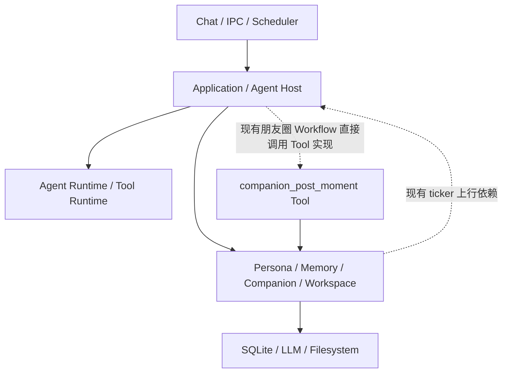

# My Agent 目标架构源码审计

## 结论与基线

审计日期为 2026-11-17，源码基线为 `3603b276`。本轮只增加审计记录和事实校正，产品代码、依赖和 UI 均维持该基线。

**目标架构尚未完整落地，当前存在 18 项待处理问题，其中 9 项 P1、9 项 P2。** 本轮没有取得可列为 P0 的远程利用或数据破坏攻击链证据。依赖扫描的 critical 等级单列处理，实际可达性需要逐条复核。

上一轮已经完成的工作包括 Core 唯一运行态、旧镜像与转发层清理、本地事务排队、Outbox 租约、部分原子用例、Headless 终态检查和注册请求约束。这些能力继续成立。上一轮从这些子项推导出“全部架构已收口”的结论超过了证据覆盖，本审计撤回该总体判断。

本轮以用户最初的 Agent Host 定位和原始施工合同为验收目标。合同中的 Agent、Runtime、Domain、Infrastructure 边界仍需在真实调用链与故障条件下成立。

## 审计范围和方法

- 对照 `docs/requirements/agent-host-architecture-v1.md`、`top-level-architecture-closeout-v1.md`、`architecture-migration-final-v1.md`、当前 Architecture 与四张模块卡。
- 遵循 `agent-skills/code-review.md` 的 L3 审查和 `security-checklist.md`，核对 DEC-037、DEC-2026-11-13-01、DEC-2026-11-13-02、DEC-2026-11-17-01。原生 SQLite 替换、完整 Event Sourcing、OS 级 Shell 强隔离维持既有决策。
- 扫描 `electron/main` 的 280 个 TypeScript 文件，提取 1478 条相对导入记录，用于定位跨层调用。这是文本级入口清单，不能替代 TypeScript 符号解析，也不能证明所有动态加载或间接依赖安全。
- 沿 Chat、Workspace、LLM Tool、IPC、Scheduler、Headless、LifeTicker、会话完成回调、Outbox 和 Memory 索引恢复追踪生产入口。
- 重点代码包括 `agent/{runtime,loop,conversation-application-service}.ts`、`agent-host/*`、`companion/{application,core,life,growth,adapters}`、`storage/{database,memory-store,session-store}.ts`、`services/{task-queue,task-plan-service}.ts`、`skills/registry.ts`、`tools/{registry,middleware}.ts`、IPC 安全包装和正式通知消费端。
- 使用临时隔离测试复现 7 项反例，真实 sql.js、临时磁盘目录、SQL 故障注入和受控异步顺序均在测试内运行。无真实付费模型请求。临时测试源完整保存在本报告附录，未加入默认测试目录。
- 执行单元测试、类型检查与构建、Eval、Skill Eval、UI E2E、资产与文档门禁、npm 依赖审计。每项结果按本次输出记录，历史 Electron 输出单独注明。

前端范围覆盖主进程接口、Tool 可见性、会话隔离、通知消费与回执。本轮没有逐页重新做人工作品级视觉验收。第三方真实供应商、安装签名、其他操作系统、断电和长期大数据量运行没有在本轮取得新证据。

## 目标架构与当前落点

| 边界 | 当前有效实现 | 仍需完成的部分 |
|---|---|---|
| Agent Loop | Think / Act / Observe、统一工具 metadata、压缩与终止原因 | 工具超时后的真实执行收敛，见 A04 |
| Runtime / Application | 有 Conversation Application Service，主副会话使用实际 Runtime | Runtime 持有具体 Companion 组装形状，缺少完整宿主执行环境，见 A12 |
| Agent Host | Domain / Capability 注册、Workflow、权限检查、Context Provider | Manifest 过滤被默认值替代，部分策略字段无消费者，见 A02、A12 |
| Persona | Role Pack、受保护身份与动态切片分离，Prompt 请求通过注册编译入口 | Manifest 的身份装配权仍不完整，见 A12 |
| Memory | SQLite 为源，索引启动扫描与配置提交唤醒，来源标记存在 | 跨领域后续记忆写入没有持久补偿任务，见 A13 |
| Companion Core | 单一 Core 运行态、事件、执行账本、Outbox、本地 Unit of Work | 命令事实 fencing、回滚外内存状态、读取初始化、角色生命周期，见 A03、A10、A16、A18 |
| Permission / IPC | Tool 权限、文件路径守卫、Headless 只读、部分特权 IPC 包装 | Manifest 与实际执行一致性、剩余 IPC 来源校验，见 A02、A08 |
| Task / Scheduler | 后台任务恢复处理器、调度 trace 元数据 | 调度 occurrence 持久账本、写盘失败传播、终态通知恢复，见 A06、A07 |
| Infrastructure | sql.js 原子文件替换、独立事务排队、Provider 与 MCP 适配 | 已提交内存与失败磁盘的一致性、依赖风险，见 A01、A09 |
| 工程门禁 | 类型、Unit、资产、文档和部分静态依赖检查 | 全分层约束、隔离夹具、反例与验收证据归属，见 A17 |



虚线对应 A11 的现有依赖。未来收口应让接入适配器和 Tool 调用同一应用用例，领域规则可独立执行和测试。

## 用户旅程和数据闭环核对

| 旅程 | 当前主要数据链 | 审计判断 |
|---|---|---|
| 主对话 | IPC → Runtime → Application 组装 → Loop → Tool / 消息保存 → 会话完成结算 | 主链可运行；激活状态与后续结算见 A05、A13 |
| Workspace 对话 | parentSession → 独立 Workspace 会话 → 同一 Runtime / Loop | 会话存储有隔离；计划与 Skill 仍可能串扰，见 A05 |
| 发朋友圈 | Tool / Workflow → Command Gateway → Life Event → Moment / Event / Outbox | 复用真实事实链；Manifest 和重试所有权见 A02、A03 |
| 朋友圈评论 | 用户交互记录直接保存，自动回复再进入角色事件和通知 | 两类事实分开符合现有合同；需继续覆盖跨人物与取消，见 A18 |
| 用户赠礼 | 应用用例 → Unit of Work → 礼物事实 / 运行态 / 事件 / 会话与窗口 Outbox | SQL 原子边界成立；磁盘提交失败和跨入口重试见 A01、A03 |
| 自动赠送信物 | 文化完成 / 关系触发 → 信物事务 → 会话与窗口 Outbox → 里程碑 | 主体有事务；后续里程碑、预算与恢复见 A13、A14 |
| 日记 / 深夜反思 | 生成 → 本地日记与事件 Outbox → 可选 feedback Memory | 日记本地原子提交；取消、后续记忆补偿见 A13、A18 |
| 文化体验完成 | 模型评语 → 资产 / 心愿 / 事件 / 可选动态同库事务 → 通知 / 可选信物 | 主体有事务；通知总预算和后续奖励补偿见 A13、A14 |
| 主动问候 | Moment → 生成 → 主会话 Outbox → 窗口预留与呈现回执 | 会话留痕早于投递预留，见 A14 |
| 定时任务 | Scheduler 定义 → 回调 → 临时会话 → Headless Runtime → 日志 / 通知 | 缺持久 occurrence 账本和完整失败恢复，见 A06 |
| 记忆新增 / 备份恢复 | SQLite 记忆事实 → 提交唤醒 / 启动扫描 → 向量差异重算 | 源与索引可恢复边界成立；跨领域“尚未写入源”的动作仍需 A13 |
| 重启 | DB 打开 → 后台任务恢复 / Outbox 重领 / 记忆索引核对 → Scheduler | 已有多个恢复器；任务终态与调度 occurrence 的覆盖不完整，见 A06、A07 |

这些链路证明存在生产执行入口。每条链路仍需满足相应的授权、事务、幂等、人物隔离与终态约束，不能用其中一个成功入口代替其余入口验收。

## 问题总表

| ID | 优先级 | 问题 | 证据级别 |
|---|---|---|---|
| A01 | P1 | 磁盘持久化失败后保留已报告失败的内存事务 | 动态复现 |
| A02 | P1 | Scoped Catalog 忽略传入 Manifest 授权 | 动态复现 |
| A03 | P1 | 执行账本所有权没有约束本地业务事实提交 | 动态复现 |
| A04 | P1 | 工具超时结束等待，执行继续产生副作用 | 动态复现 |
| A05 | P1 | Skill 与任务计划通过全局变量串扰会话 | 两项动态复现 |
| A06 | P1 | Scheduler occurrence 缺少持久执行与恢复闭环 | 源码确认 |
| A07 | P1 | Task Queue 吞掉持久化失败且终态通知恢复不完整 | 源码确认 |
| A08 | P1 | 特权 IPC 来源校验没有全入口覆盖 | 源码确认，利用链未验证 |
| A09 | P1 | 锁定依赖存在 critical / high 公告 | npm 当前扫描，实际可达性待核验 |
| A10 | P2 | 宿主关怀冷却未按人物持久化且不能随事务回滚 | 动态复现与源码确认 |
| A11 | P2 | Domain 与 Electron、Host、Tool 的边界仍混合 | 源码确认 |
| A12 | P2 | Manifest 尚未成为完整执行环境的装配事实源 | 源码确认 |
| A13 | P2 | 对话后结算与跨领域后续动作缺少持久补偿 | 源码确认 |
| A14 | P2 | 主动提醒预算与问候会话留痕仍有旁路 | 源码确认 |
| A15 | P2 | 命令、事件和 Outbox 的因果标识未贯通 | 源码确认 |
| A16 | P2 | 声明只读的运行态查询会初始化并持久化事实 | 源码确认 |
| A17 | P2 | 架构门禁、夹具隔离和完工判定不足 | 本次失败输出与源码确认 |
| A18 | P2 | 后台生成缺少提交前角色复核和取消传播 | 源码确认，切换竞态未动态复现 |

## P1 详细发现

### A01 磁盘失败后的提交状态分叉

位置为 `electron/main/storage/database.ts:63` 与 `electron/main/storage/database.ts:711`。`withDatabaseTransaction` 执行 SQL COMMIT，设置 `committed=true` 后调用 `persist()`。文件替换失败进入 catch 时不会回滚内存事实。

反例在 `renameSync` 故障注入下使事务返回“数据库保存失败”，随后查询仍得到 `failed-commit` 行。后续任意成功持久化可能把这次失败事实带入磁盘。调用方据失败重试时会面对“失败操作已生效”的状态。

修复需要明确成功提交的线性化点及失败恢复策略。保留 sql.js 时应在提交失败后恢复到一致状态，或将存储置为显式不可写并要求恢复，不能继续以普通失败对外响应后允许下一次写入静默带入旧事实。实施时需保留数据库引用与性能约束。

验收需覆盖 export / 临时文件写入 / rename 故障、后续成功写入、独立磁盘重开及重试，验证失败事实不会被后续保存夹带。

### A02 传入 Manifest 的授权没有控制会话工具目录

位置为 `electron/main/agent-host/scoped-catalog.ts:16`、`electron/main/agent-host/host.ts:48` 与 `electron/main/agent-host/adapter.ts:20`。Scoped Catalog 只取 `manifest.id`，再调用 `getAgentHostToolNamesForRole` 创建默认宽权限 Manifest。传入的 `domainKeys`、allow / deny、grantedPermissions 没有完整参与筛选。已注册 Tool 的权限又来自注册时的默认 Manifest。

反例使用空 Domain、空 allow、空 permissions 的 Manifest，过滤后仍包含 `capability_companion_diary_generate`。当前生产默认 Manifest 本来授予这些能力，本轮没有证明用户可直接提交自定义 Manifest 越权；已证明框架提供的收紧策略不能兑现。

修复应从当前完整 Manifest 生成目录与执行环境，并在实际 invoke 时复核同一授权。需为普通内置 Tool 的宿主授权范围形成明确契约，保留下层文件与工具权限检查。

验收应包含 deny 单能力、deny Domain、撤权、空权限、自定义 toolName、执行阶段重校验和两个会话的不同 Manifest。

### A03 执行租约只保护账本结果

位置为 `electron/main/companion/core/execution/ledger.ts:15`、`electron/main/companion/core/execution/ledger.ts:77`、`electron/main/companion/core/commands/gateway.ts:20`。10 分钟前的 running 被转为 retryable，旧 handler 没有被取消。`finishCompanionExecution` 限制 commandId，但领域提交没有统一检查当前执行所有权。多数用例为新内容生成 UUID，事件幂等键也随之变化。

反例阻塞旧 handler，把 started_at 置为过期后重试同键命令，重试提交 `new-owner`，旧 handler 随后仍提交 `old-owner`，最终出现两条事实。实际崩溃窗口中，“事实已提交、completed 尚未保存”的重试也需要用例级稳定幂等，而当前 Gateway 未提供完整保障。

修复应在本地事实事务中验证 command / attempt fencing，并把稳定 operation key 传到用例事实与事件的唯一约束。生命周期元数据继续遵循 DEC-2026-11-13-01，不把模型等待放入事务。

验收需覆盖活跃超时、旧执行迟到、事实提交后强退、同键重试、真实重启和不同人物相同幂等键。

### A04 工具超时后仍继续执行

位置为 `electron/main/tools/registry.ts:12`、`electron/main/tools/registry.ts:199`。`withTimeout` 只 reject 等待方，没有建立超时取消的子 AbortController。原工具继续运行，中间件将超时转换成可重试错误。

反例让写工具在第 31 秒产生副作用，30 秒时等待方已经失败，signal 未取消，第 31 秒仍完成写入。用户停止、下一轮模型重试和迟到执行可能交叠。

修复应将 deadline、取消和执行终态传到工具及其子进程 / HTTP 请求。对于不能中断的副作用，需要幂等提交或明确“执行状态未知”，并避免自动重发同一动作。单纯让 Promise 提前返回不能满足完成语义。

验收需覆盖 timeout、用户取消、超时后重试、晚到成功、Shell 派生进程、模型图片 HTTP 和文件提交前复核。

### A05 Skill 与任务计划的全局可变作用域

位置为 `electron/main/skills/registry.ts:11`、`electron/main/skills/registry.ts:97`、`electron/main/services/task-plan-service.ts:22`、`electron/main/tools/builtins/task-plan.ts:67` 与 `electron/main/agent/runtime.ts:481`。Skill 激活写入模块单值，Runtime 的过滤和最终清理读取同一值；任务计划 Tool 忽略调用上下文，读取全局 currentSessionId。

两项反例分别验证会话 B 覆盖会话 A 的 activeSkill，以及 ctx.sessionId=A 的任务计划写入最近设置的 B。Runtime 的活动锁按 sessionId 隔离，允许不同会话同时运行，现有全局状态无法满足这种执行模式。

修复应按 Agent / Session / Run 明确激活生命周期，工具只能消费本次 ToolContext。清理 A 的状态不得清除 B 的激活，计划读写不得用全局默认会话恢复。

验收需通过正式 Runtime 并发主 / Workspace / Headless 会话，验证 Skill 正文、白名单、计划创建 / 更新 / 清理和取消均按会话隔离。

### A06 Scheduler 没有持久 occurrence 执行账本

位置为 `electron/main/scheduler/index.ts:101`、`electron/main/scheduler/index.ts:22`、`electron/main/agent/runtime.ts:707`。回调先保存 `last_run_at`，随后才运行 Headless。`idempotencyKey` 被用于 trace / 日志，当前调度路径未持久化 queued / running / completed / failed occurrence 并据此恢复。任务定义没有绑定 Agent 身份，Headless 新会话沿当时默认身份创建。

进程在保存 last_run_at 后、执行完成前退出，下次调度会按新的时间基点推进，原 occurrence 无法确定恢复。任务结果失败仅记日志，缺少可查询的持久失败结果。是否允许“跟随当前人物”的调度语义也尚未形成明确宿主契约。

修复应建立稳定 taskId + scheduledAt 的本地运行记录，保存执行身份和终态，定义漏跑 / 重复 / 失败的恢复策略。通知与业务结果由持久运行记录驱动。

验收需覆盖三个强退窗口、同一 occurrence 重启重领、失败可见、无重复收费请求策略，以及创建任务后切换人物的确定语义。

### A07 Task Queue 持久化失败被吞掉

位置为 `electron/main/services/task-queue.ts:81`、`electron/main/services/task-queue.ts:163` 与 `electron/main/services/task-queue.ts:413`。`dbUpsertTask` 对全部持久化失败只记录日志，关键运行与完成状态仍继续推进。notify 在确认窗口投递之前设置 notified；启动恢复只读取 pending / running。

因此入队 / running 保存失败后仍可执行，产生没有可靠恢复记录的任务。完成保存失败可能留下旧 running，重启再次执行。无窗口时先写 notified，随后没有实际投递；已经完成且未通知的磁盘记录也缺少统一启动载入路径。

修复应区分关键提交和可丢弃观测，关键持久化失败必须反馈给执行器。恢复时加载待执行和待投递终态，通知采用稳定幂等键与可恢复投递状态。

验收需注入每个关键状态的 SQL / persist 故障，覆盖无窗口、窗口 send 失败、完成后强退和重启投递，不以日志成功替代落盘成功。

### A08 特权 IPC 校验没有覆盖全部入口

位置为 `electron/main/ipc/settings.ts:125`、`electron/main/ipc/mcp.ts:233`、`electron/main/index.ts:276` 与 `electron/main/ipc/ipc-security.ts:11`。Settings 保存、部分 MCP 管理及 updater 仍直接注册 handler，未统一经过 sender 校验。共同校验器在 senderFrame / owner 缺失时也允许继续，未校验受信任应用 URL。

这是可确认的控制面缺口。本轮没有构造远程页面获得 preload 并利用这些接口的完整攻击链。BrowserWindow 的 sandbox、contextIsolation、导航和外链限制会降低暴露面，不能据缺少包装直接断言已存在远程代码执行。

修复应统一特权入口注册与主框架 / 来源 / 生命周期校验，测试夹具的省略事件分支应在测试适配层表达。异步外部请求还需绑定原 sender 和取消归属。

验收需对每个特权通道注入子框架、销毁、导航、无 owner 和错误来源负例，确保副作用前失败。架构门禁应覆盖直接 ipcMain.handle / on 和动态注册。

### A09 当前锁定依赖的安全公告

本次 npm 官方 registry 扫描报告全部依赖 29 项，含 2 critical、13 high、12 moderate、2 low；`--omit=dev` 报告 16 项，含 2 critical、8 high、4 moderate、2 low。重点包括 DOMPurify、proxy-addr、MCP SDK、sharp、js-yaml、zod 和 undici。

锁文件中的关键版本为 DOMPurify 3.4.13、proxy-addr 2.0.7、MCP SDK 1.30.0、sharp 0.35.4、Electron 42.9.1、js-yaml 4.3.1、zod 4.4.3。

这些是依赖图命中公告的数量，传递依赖可重复关联同一根因，扫描等级不等于本产品已具备对应利用条件。Electron / Vite / 打包链也需要按实际开发、构建和分发路径复核，不能只看 dependencies 分类判断部署暴露。

初步调用核对已定位 MCP OAuth 客户端、sharp 图片解码与 js-yaml 的用户 Skill 解析。Mermaid 使用 strict 模式，应用源码未直接启用 DOMPurify 的 SAFE_FOR_TEMPLATES / DOM-returning 组合，因此本轮没有证明上述 critical 公告在该产品路径可利用。sharp 在 metadata 后只接受 PNG / JPEG / WebP，但仍需核实公告所涉解析阶段。proxy-addr 的服务器信任配置适用性尚未取得证据。

应继续确定各公告的安装版本、调用路径和发布产物可达性，再升级并跑对应回归。npm 自动给出的 electron-builder 降级或跨 major 修复不能直接采用。

代表性公告保留在文末来源，完整 JSON 位于本地验证记录。验收应保留修复前后扫描、风险适用性结论、真实图片 / MCP / Markdown 和打包验证。

## P2 详细发现

### A10 宿主关怀冷却不满足人物隔离与事务恢复

位置为 `electron/main/companion/life/host-presence.ts:40`、`electron/main/companion/life/host-presence.ts:143`、`electron/main/companion/life/host-presence.ts:196`。lastCareTriggeredAt 按 kind 保存，跨人物共用；熬夜标记同样为全局内存。内存更新发生在本地事务回调内，SQL 回滚无法撤销该内存赋值。

反例让领域事件 INSERT 失败，数据库零事件，立即重试仍因内存冷却返回 null。重启则清空该冷却与熬夜线索。共享主动预算限制部分频率，但没有恢复这些具体关怀事实与人物归属。

修复应把人物关怀事实 / 冷却来源与宿主全局活动采样分开，冷却从已提交领域数据推导或持久化，内存缓存只在提交后更新。验收覆盖人物切换、事务失败、重启和次日日剧本线索。

### A11 领域依赖仍跨越宿主边界

位置为 `electron/main/companion/life/host-presence.ts:22`、`electron/main/companion/life/assets.ts:13`、`electron/main/companion/life/ticker.ts:12`、`electron/main/agent-host/builtin-domains.ts:38`。生活规则直接依赖 Electron 电源管理与应用路径，ticker 位于 Companion 内部并向上调用 Agent Host，Domain Definition 的朋友圈 Workflow 反向调用 Tool 实现。

这些路径意味着“Domain 不依赖 Electron / Runtime / 接入方式”的合同目标尚未完成。ticker 可以明确归 Application Adapter；资产文件与宿主活动采样应以端口进入领域。朋友圈业务规则应归应用用例，Tool 与 Workflow 同向调用该用例。目录改名本身不构成修复，需以可独立执行和测试证明。

验收需覆盖 Domain 导入扫描、无 Electron 环境领域测试，以及 UI / Workflow / Tool 调用同一用例的语义一致性。

### A12 Manifest 与 Runtime 执行环境仍不完整

位置为 `electron/main/agent-host/builtin-domains.ts:166`、`src/shared/agent-host.ts:17`、`electron/main/agent/conversation-application-service.ts:15` 与 `electron/main/agent/runtime.ts:259`。modelPolicyKey、permissionPolicyKey、skillKeys 等主要被声明或展示，未成为实际模型路由、权限策略与 Skill 集合的唯一装配输入。Runtime 仍选择 companion-default 并直接消费 Companion 组装结构。ExecutionContext 缺少统一 signal、deadline、runId 和稳定操作幂等字段。

修复需先定义各 Manifest 字段的真实消费者和执行上下文，删除无效的完成宣称。通过已确认的 Host 装配边界提供执行环境，避免为每个领域再堆一套 Registry。验收应以两个拥有不同身份、模型、Skill 和权限组合的 Agent 实例证明策略真实生效，并覆盖 Workspace / Headless。

### A13 后续业务副作用没有持久补偿

位置为 `electron/main/agent/conversation-application-service.ts:125`、`electron/main/companion/life/nightly-reflection.ts:249` 与 `electron/main/companion/growth/relationship-keepsake.ts:347`。对话后体征和共鸣使用未等待的 Promise，失败只记日志；深夜反思的 feedback Memory 在日记事务之后直接执行，失败后没有待处理记录；信物里程碑同样在主要事实提交后执行。

跨领域动作分开提交具有合理性，但当前没有持久 saga / 工作项 / Outbox 记录供重启补偿。失败或退出可能让“日记已写、感悟未沉淀”“信物存在、里程碑未更新”长期保留。

修复应为必须最终完成的后续动作建立稳定来源键和持久任务，明确可选观测与产品事实的差别。验收覆盖后续写入失败、进程退出、幂等重试和重建，保留已提交主事实。

### A14 主动提醒预算和问候留痕存在旁路

位置为 `electron/main/companion/life/ticker.ts:97`、`electron/main/companion/life/chat-resonance.ts:596`、`src/App.tsx:478` 与 `electron/main/companion/life/proactive-greeting.ts:172`。ticker 的文化推进标记为 userFacing=false，但完成后会产生正式 Toast，自动信物又可追加 Toast，未经过共享预算。总预算当前只包住部分 ticker 动作与 moment-tips。

问候在判断窗口可用和当天投递预留前先入主会话，每次使用随机 messageId。无窗口或投递证据不可用会返回 greeted=false，预算释放，而会话写入可能已经发生，下一 tick 可重复追加。

修复应将自动打扰策略放在用户可见投递边界，并区分内容自然产生和主动通知。问候使用稳定人物 / 日期 / 来源键，将会话留痕与投递尝试建立一致关系。验收覆盖文化完成连带赠礼、无窗口多 tick、失败与重启，检查真实会话消息数及 Toast 数。

### A15 命令因果标识没有贯通

位置为 `electron/main/companion/life/ticker.ts:37`、`electron/main/companion/application/record-event-notify.ts:46` 与 `electron/main/companion/life/chat-resonance.ts:543`。Gateway 产生 commandId / executionId / correlationId，但多数 action 不消费这些参数；记录器把 sourceId 自身当 correlationId。执行事件关联只有局部文化链路使用。

因此 trace、账本和 Outbox 虽各自有字段，仍不能普遍从一个用户命令定位其全部事实和投递。这也妨碍 A03 的幂等恢复。

修复应将统一 Command Context 传播到应用提交和事件来源，明确一对多事件如何关联执行；验收需要从 Chat、IPC、ticker、Scheduler 的入口 ID 查到领域事件、会话消息和外部投递，跨重试保留因果链。

### A16 只读查询会初始化运行态

位置为 `electron/main/companion/core/read-models/runtime-read-model.ts:11`、`electron/main/companion/core/state/runtime-state.ts:60`。`getCompanionRuntimeReadModel` 委托可初始化的 getter；缺失数据时建表、从 Role Pack 生成运行态并落盘。能力被注册为 query，metadata 声明只读。

Debug 专用快照已使用直接解码路径，不能据此推导所有查询均只读。生产能力的读写语义仍有分叉。

修复应把读取和显式 ensure / 初始化生命周期分开。查询缺失时返回明确缺失或未就绪，Host 初始化负责创建状态。验收比较查询前后 schema / 行 / 文件内容，覆盖新人物与未知人物，确保声明只读的路径零写入。

### A17 架构与测试门禁不足以支持总体完工

位置为 `__tests__/unit/architecture-boundaries.test.ts:16`、`__tests__/unit/character-draft-store.test.ts:12`、`__tests__/unit/universe-switch.test.ts:8` 与上一轮冻结合同。静态门禁只约束 storage、llm、agent→ipc、tools/builtins 的部分直接依赖，未覆盖 Domain→Electron / Host、Manifest 消费、全局会话状态、持久化失败与业务事实 fencing。

本次默认 Unit 在并行 UI 构建期间有 5 项失败，包含超时和共享 `.agent-data/character-drafts` 目录被另一测试清理的 ENOENT。`character-draft-store` 的 afterEach 删除整个共享草稿目录，`universe-switch` 同时在其中写入。降低并发后的复跑只作为定位证据，不取消默认命令的不稳定问题。

UI 首次启动在 webServer 60 秒门限内未就绪，本轮没有提高超时掩盖。重跑还发现确定的断言漂移，chat.test.ts 等待“常量 真实接口测试定义”，实际按钮为“真实接口测试定义”；行为日志把“读取失败”断言在 alert 内，快照显示该文字在普通段落、alert 使用另一条说明；外观测试期待已经不存在的重复标题。它们需要按确认后的正式语义修正测试，不能靠增加等待时间处理。完成结论必须包含失败输出、真实跳过、未覆盖领域，以及与源码基线绑定的证据。修复需隔离每个测试的临时目录、补故障反例与完整分层规则，再定义可执行的合同完成判定。

### A18 后台生成缺少统一生命周期取消

位置为 `electron/main/companion/life/nightly-reflection.ts:131`、`electron/main/companion/life/nightly-reflection.ts:172`、`src/shared/agent-host.ts:17` 与 `electron/main/companion/life/ticker.ts:140`。深夜反思在模型请求前校验 active role，模型结束后到落库没有统一的再次校验，Host 上下文没有 signal。stopLifeTicker 清除未来 timer，无法中止正在生成的工作。

从执行顺序可推断，生成期间切换角色或关闭生命周期后，旧请求仍可能落入旧人物数据并发出通知。本轮未做真实角色切换屏障的动态复现，保留此验证边界。

修复应对后台 run 传递 role / universe / lifecycle epoch 和 AbortSignal，提交前核对归属与当前策略。验收需在模型等待、事务前、提交后投递前三个屏障切角或停止，确保暂停语义、留痕和预算一致。

## 已确认成立的设计与边界

- 模块化单体适合当前本地桌面形态。现有证据不要求拆微服务或引入分布式队列。
- Loop 与 Runtime 已有独立职责，Conversation Application Service 确实接管部分对话后伙伴业务，后续继续按真实用例收口。
- Persona、当前世界态、长期 Memory 与会话 Context 有分离的生产落点。不能因为存在 A12 就否认这些已实现的边界。
- Core 唯一运行态与 legacy 文件清理有效，同库 Unit of Work 能回滚 SQL 事实。A01 与 A10 分别涉及持久化阶段和事务外内存。
- Outbox 已有租约、退避、次数上限和 attempt 终态 fencing。会话投递按消息 ID 幂等。至少一次投递仍需消费者幂等，不能宣称每个窗口只看见一次。
- Permission Engine、动态 Tool metadata、路径守卫和 Headless 只读策略有生产实现。A02 与 A08 是仍需补齐的控制面。
- 主模型和辅助模型沿统一工厂，模型请求由注册编译配方签发；Memory 向量索引已有启动重算和提交唤醒，当前没有证据要求重写这些部分。
- Debug 来源已迁到 Core，Playground 隔离故事与生产资产注册有门禁。本轮未发现足以证明全产品视觉一致性的新增证据。

## 修复顺序与验收终点

1. 先处理 A01、A03、A04 的执行与提交一致性，再补 A05、A02 的会话与授权边界。这些问题会影响后续所有用例的可靠性。
2. 收口 A06、A07 的后台运行与恢复，以及 A08 的 IPC 来源控制。A09 逐公告核验与升级，独立保持可回滚。
3. 完成 A10、A13、A14、A18 的人物生命周期、业务后续任务和打扰策略。
4. 按实际调用链收口 A11、A12、A15、A16，并将 A17 的门禁覆盖到每个已修不变量。

每个修复项需要在新施工合同中列出允许改动范围、稳定 operation key、事务边界、故障屏障、人物 / 会话隔离和完整验证命令。审计文档没有授予批量产品变更或新的 UI 回流许可。

整体完工应同时满足 18 项分别关闭或有用户确认的决策处置、完整生产入口覆盖、故障与重启回归、当前代码门禁通过、模块卡和架构事实一致。通过数量、文件搬迁和合同冻结都不能单独作为完工依据。

## 本轮验证记录

下表将本次运行与历史证据分别标明。

| 验证 | 本轮结果与解释 |
|---|---|
| 隔离故障探针 | 7 项反例成立，整理后的报告附录源再次运行 7 项通过；它们断言缺陷存在 |
| 默认 Unit 首轮 | 1781 通过、5 失败、1 跳过；与 UI 构建并行时出现超时和共享草稿目录 ENOENT |
| Unit maxWorkers=1 | 1768 通过、18 失败、1 跳过；UI 并行运行期间仍有超时及超时后的清理错误 |
| Unit 关闭文件并行 | 1783 通过、3 失败、1 跳过；剩余 3 项均为 5 秒超时 |
| 上述 3 个文件单独复核 | 57 项通过，说明失败对执行环境 / 组合负载敏感；保留原始失败记录 |
| 最终默认 Unit 复跑 | 1785 通过、1 失败、1 跳过；file-tool-permission 的大量文件边界用例超过 15 秒。完整失败日志继续保留，随后的低负载串行结果单列 |
| UI 运行中断后的串行 Unit | 284 个文件、1786 项通过，1 个文件 / 用例既有跳过；执行命令为 `npm run test -- --fileParallelism=false --maxWorkers=1`，原组合负载失败与共享目录缺口继续保留 |
| npm run build | 通过，包含 Renderer / 主进程双类型检查与 Vite 构建；保留已有 chunk / dynamic import 警告 |
| eval:run / eval:skill | 分别 23 项与 1 项通过；没有运行真实付费 persona Eval |
| npm run assets:check | 113 项通过，资产家族 14、ModelContextAssetType 18 |
| UI 首轮 | webServer 在 60 秒内未就绪，未进入用例执行 |
| UI 全量重跑 | 计划 691 项，日志记录 431 通过、15 失败；会话失效且无完整结束摘要，另外 245 项没有完成结果，不能标记全量通过 |
| Electron | 本轮未重新执行整套；同源码基线的上一轮记录为 41 通过、5 项真实模型配置不足而跳过，仅作为历史证据 |
| npm audit | 29 个依赖项命中公告，退出非零；2 critical / 13 high / 12 moderate / 2 low |
| npm audit --omit=dev | 16 个依赖项命中公告，退出非零；2 critical / 8 high / 4 moderate / 2 low |
| 文档与差异 | docs:validate 与 git diff --check 通过；本轮无 staged 产品代码、测试或 Eval，路径影响映射跳过 |
| 独立 lint | 仓库未配置独立 lint 命令，没有宣称另行 lint 通过 |

本轮审计已确认门禁存在失败及未完成范围，因此审计结论为“需要继续架构施工”。文档提交只交付审计结果，18 项产品缺口仍按 WISH-050 保持待处理。


原始本地记录位于 `var/verification/architecture-audit-*`，包含 imports JSON、依赖公告 JSON、Unit、build、UI 和故障注入输出；该目录不进入版本库。可独立复核的反例源和步骤保存在下方附录。

## 依赖公告来源

npm 官方 registry 的当前扫描输出支持 A09 的统计。代表性根因公告如下，适用性仍按实际调用复核。

- DOMPurify SAFE_FOR_TEMPLATES 与 shadow root 的模板表达式清理问题。[安全公告](https://github.com/advisories/GHSA-cg2g-xh64-v4q7)
- proxy-addr IPv4-mapped IPv6 信任网段问题。[安全公告](https://github.com/advisories/GHSA-jqcg-44mw-7w3h)
- MCP SDK OAuth 授权服务器选择问题。[安全公告](https://github.com/advisories/GHSA-6qxp-vccf-f47h)
- sharp 底层 librsvg 问题。[安全公告](https://github.com/advisories/GHSA-wq5f-xc86-pv6w)

## 附录一 反例结果与复现方式

7 项探针断言的目标是证明当前缺陷仍存在，因此“7 passed”表示反例成立。修复后应将它们转换成正确行为断言，再加入正式回归。

| 探针 | 故障屏障 / 输入 | 当前观察 |
|---|---|---|
| A01 | renameSync 失败一次 | 返回保存失败，内存事实仍在 |
| A02 | 空授权完整 Manifest | 仍可见日记生成 Tool |
| A03 | 旧 handler 阻塞，租约过期，重试后释放旧 handler | 两份副作用均存在 |
| A10 | 关怀领域事件 INSERT trigger 报错 | SQL 回滚，内存冷却仍阻止重试 |
| A04 | 工具 31 秒完成，30 秒超时 | signal 未取消，第 31 秒仍改变状态 |
| A05-1 | A 与 B 会话依次激活 Skill | B 覆盖全局激活，清理影响整个进程 |
| A05-2 | 全局会话设为 B，ToolContext 指定 A | 计划写入 B |

把下面的源保存为 `__tests__/unit/architecture-audit-probe.test.ts`，执行 `npx vitest run __tests__/unit/architecture-audit-probe.test.ts`。该文件只在临时目录写隔离数据库，不调用真实模型。执行完成后移除临时测试文件，避免把缺陷断言作为正常行为长期固化。

```typescript
import fs from 'node:fs';
import os from 'node:os';
import path from 'node:path';
import { afterEach, beforeEach, expect, it, vi } from 'vitest';
const fixture = vi.hoisted(() => ({
    directory: ''
}));
vi.mock('electron', () => ({
    app: {
        getPath: () => fixture.directory
    }, powerMonitor: {
        getSystemIdleTime: () => 0
    }, BrowserWindow: {
        getAllWindows: () => []
    }, safeStorage: {
        isEncryptionAvailable: () => false
    }
}));
const database = await import('../../electron/main/storage/database');
beforeEach(async () => {
    fixture.directory = fs.mkdtempSync(path.join(os.tmpdir(), 'architecture-audit-'));
    const db = await database.getDatabase();
    db.run('CREATE TABLE audit_facts(id TEXT PRIMARY KEY)');
    database.persist();
});
afterEach(() => {
    vi.restoreAllMocks();
    database._resetDatabaseForTests();
    fs.rmSync(fixture.directory, {
        recursive: true, force: true
    });
});
it('审计复现 A01 磁盘替换失败后，内存保留已报告失败的事务事实', async () => {
    const rename = vi.spyOn(fs, 'renameSync').mockImplementationOnce(() => {
        throw new Error('audit-disk-failure');
    });
    await expect(database.withDatabaseTransaction(async (db) => {
        db.run("INSERT INTO audit_facts VALUES ('failed-commit')");
    })).rejects.toThrow('数据库保存失败');
    rename.mockRestore();
    expect((await database.getDatabase()).exec('SELECT id FROM audit_facts')[0]?.values).toEqual([['failed-commit']]);
});
it('审计复现 A02 空授权 Manifest 仍可见默认 Host 能力', async () => {
    const { createCompanionAgentManifest } = await import('../../electron/main/agent-host/builtin-domains');
    const { getAgentHostTools } = await import('../../electron/main/agent-host/host');
    const { AgentHostScopedToolCatalog } = await import('../../electron/main/agent-host/scoped-catalog');
    const manifest = {
        ...createCompanionAgentManifest({
            id: 'luffy', personaKey: 'role:luffy', domainKeys: [], allowCapabilities: []
        }), grantedPermissions: []
    };
    const visible = new AgentHostScopedToolCatalog(manifest).filter(getAgentHostTools());
    expect(visible.map(tool => tool.name)).toContain('capability_companion_diary_generate');
});
it('审计复现 A03 活跃旧命令被回收后仍能提交第二份副作用', async () => {
    const { executeCompanionCommand } = await import('../../electron/main/companion/core/commands/gateway');
    const { resetCompanionCoreSchemaForTesting } = await import('../../electron/main/companion/core/schema');
    resetCompanionCoreSchemaForTesting();
    let enter!: () => void, release!: () => void;
    const started = new Promise<void>(resolve => {
        enter = resolve;
    });
    const held = new Promise<void>(resolve => {
        release = resolve;
    });
    const first = executeCompanionCommand({
        roleId: 'luffy', actionType: 'audit', idempotencyKey: 'same-command', handler: async () => {
            enter();
            await held;
            (await database.getDatabase()).run("INSERT INTO audit_facts VALUES ('old-owner')");
            database.persist();
            return 'old';
        }
    });
    await started;
    (await database.getDatabase()).run('UPDATE companion_execution_runs SET started_at=0');
    await executeCompanionCommand({
        roleId: 'luffy', actionType: 'audit', idempotencyKey: 'same-command', handler: async () => {
            (await database.getDatabase()).run("INSERT INTO audit_facts VALUES ('new-owner')");
            database.persist();
            return 'new';
        }
    });
    release();
    await first;
    expect((await database.getDatabase()).exec('SELECT COUNT(*) FROM audit_facts')[0]?.values[0][0]).toBe(2);
});
it('审计复现 A10 关怀事务回滚仍消费内存冷却', async () => {
    const { ensureCompanionCoreSchema } = await import('../../electron/main/companion/core/schema');
    const host = await import('../../electron/main/companion/life/host-presence');
    const now = new Date(2026, 10, 17, 12).getTime();
    host.resetHostPresenceStateForTesting(now - 130 * 60000);
    await ensureCompanionCoreSchema();
    const db = await database.getDatabase();
    db.run("CREATE TRIGGER audit_fail_event BEFORE INSERT ON companion_domain_events BEGIN SELECT RAISE(ABORT, 'audit-event-failure'); END");
    await expect(host.checkAndTriggerHostCare('luffy', now, 'fatigue_break')).rejects.toThrow('audit-event-failure');
    db.run('DROP TRIGGER audit_fail_event');
    expect(db.exec('SELECT COUNT(*) FROM companion_domain_events')[0]?.values[0][0]).toBe(0);
    expect(await host.checkAndTriggerHostCare('luffy', now + 1000)).toBeNull();
});
it('审计复现 A04 工具超时后执行仍继续且信号没有取消', async () => {
    const { ToolRegistry } = await import('../../electron/main/tools/registry');
    vi.useFakeTimers();
    try {
        let mutated = false;
        const controller = new AbortController();
        const tool = {
            name: 'audit_slow_write', description: '', parameters: {
                type: 'object' as const, properties: {}
            }, metadata: {
                isReadOnly: false, isDestructive: true, isConcurrencySafe: false
            }, execute: async () => {
                await new Promise(resolve => setTimeout(resolve, 31000));
                mutated = true;
                return 'written';
            }
        };
        const registry = new ToolRegistry();
        const result = (registry as any).rawExecute({
            tool, call: {
                id: 'audit', name: tool.name, arguments: '{}'
            }, args: {}, toolContext: {
                signal: controller.signal
            }
        });
        const failure = expect(result).rejects.toThrow('timed out');
        await vi.advanceTimersByTimeAsync(30000);
        await failure;
        expect(controller.signal.aborted).toBe(false);
        await vi.advanceTimersByTimeAsync(1000);
        expect(mutated).toBe(true);
    }
    finally {
        vi.useRealTimers();
    }
});
it('审计复现 A05-1 Skill 激活由全局单值持有并被其他会话覆盖', async () => {
    const { createSkillActivationTool, getActiveSkill, clearActiveSkill } = await import('../../electron/main/skills/registry');
    const make = (name: string) => ({
        meta: {
            name, description: name
        }, body: name, filePath: name, source: 'builtin' as const
    });
    await createSkillActivationTool(make('session-a')).execute({}, {
        sessionId: 'a', roleId: 'luffy', workdir: '.'
    });
    expect(getActiveSkill()?.meta.name).toBe('session-a');
    await createSkillActivationTool(make('session-b')).execute({}, {
        sessionId: 'b', roleId: 'other', workdir: '.'
    });
    expect(getActiveSkill()?.meta.name).toBe('session-b');
    clearActiveSkill();
    expect(getActiveSkill()).toBeNull();
});
it('审计复现 A05-2 任务计划工具忽略调用会话并写入最近的全局会话', async () => {
    const { setCurrentSessionId } = await import('../../electron/main/services/task-plan-service');
    const { taskPlanTool } = await import('../../electron/main/tools/builtins/task-plan');
    setCurrentSessionId('a');
    setCurrentSessionId('b');
    await taskPlanTool.execute({
        action: 'create', goal: 'audit-goal', steps: '["audit-step"]'
    }, {
        sessionId: 'a', roleId: 'luffy', workdir: '.'
    });
    expect((await database.getDatabase()).exec('SELECT session_id FROM task_plans')[0]?.values).toEqual([['b']]);
});
```
